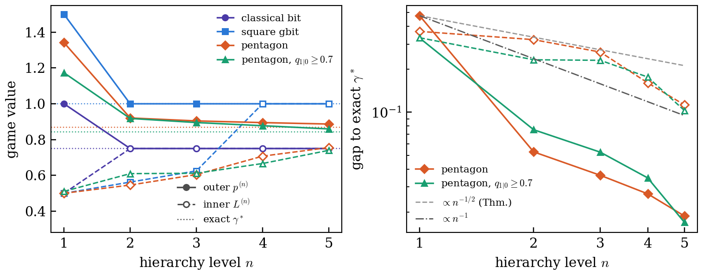

# Numerics for "Finite de Finetti for convex bodies and polynomial optimization"

Code and data behind the section *Numerical illustration: non-local games
over polygon theories* of

> J. A. Zeiss, G. Koßmann, R. Schwonnek, M. Plávala,
> *Finite de Finetti for convex bodies and polynomial optimization*,
> [arXiv:2601.15184](https://arxiv.org/abs/2601.15184).

The paper's convergent outer hierarchy (theorem *Convergence of the
hierarchy*) and its rounding scheme (theorem *Convergent inner sequence*)
are applied to the assemblage value γ\*(G) of the CHSH game for four
experiments with polytopic local state spaces K_B — the classical bit, the
square gbit ("boxworld"), the strongly self-dual regular pentagon, and the
pentagon with the local inequality constraint q_{1|0} ≥ 0.7. For polytopes
every level of the hierarchy is an **exact linear program**; the rounded
points are explicit feasible strategies; and the exact optimum γ\* is computed
directly and certified in exact arithmetic, so that the finite-level bounds can
be compared with the exact answer:

    L^(n)  ≤  γ*(CHSH)  ≤  p^(n)        for every level n.

**All implementation details — the LP formulation, the exact reductions, the
rounding pipeline, the exact reference computation, the cross-check without
reductions, the optimizer-dependence study and a reproduction guide — are in
the companion document [`implementation_notes.pdf`](implementation_notes.pdf).**

## Table 1 of the paper (CHSH, winning probabilities)

| K_B                    |        | n=1    | n=2    | n=3    | n=4    | n=5    | γ\* (exact)            |
|------------------------|--------|--------|--------|--------|--------|--------|------------------------|
| classical bit          | p^(n)  | 1.0000 | 0.7500 | 0.7500 | 0.7500 | 0.7500 | 3/4 = 0.7500           |
|                        | L^(n)  | 0.5000 | **0.7500** | 0.7500 | 0.7500 | 0.7500 |                    |
| square gbit            | p^(n)  | 1.5000 | 1.0000 | 1.0000 | 1.0000 | 1.0000 | 1                      |
|                        | L^(n)  | 0.5000 | 0.5625 | 0.6250 | **1.0000** | 1.0000 |                    |
| pentagon               | p^(n)  | 1.3416 | 0.9208 | 0.9042 | 0.8949 | 0.8868 | (2√5−1)/4 ≈ 0.8680     |
|                        | L^(n)  | 0.5000 | 0.5459 | 0.6044 | 0.7074 | 0.7555 |                        |
| pentagon, q_{1\|0} ≥ 0.7 | p^(n) | 1.1733 | 0.9181 | 0.8952 | 0.8774 | 0.8597 | 3(9+√5)/40 ≈ 0.8427   |
|                        | L^(n)  | 0.5106 | 0.6097 | 0.6118 | 0.6664 | 0.7399 |                        |

Outer levels p^(n) are LP optima of the complete (reduced) facet description
(HiGHS, tolerances ~1e-8); inner values L^(n) are values of explicit feasible
strategies obtained by rounding the optimizer returned by the LP solver; the
last column holds the exact optima (closed forms certified over Q(√5)). The
bracket closes at n=2 for the classical bit and at n=4 for the square gbit
(bold). Data: `results.json`; figure: `hierarchy_convergence.pdf`.

## Installation

Python ≥ 3.10 with

    pip install -r requirements.txt        # numpy, scipy, highspy, matplotlib

Optional: `pycddlib` ≥ 3.0 (built against cddlib/GMP) for the
vertex-enumeration cross-check of `exact_game_value.py` (`--no-vertices` runs
without it); `mpmath` for the rigorous interval certificates in
`unreduced_checks/` (`--no-certify` skips them); `nbformat`, `nbclient`,
`ipykernel` to rebuild the notebook. The shipped data were produced with
Python 3.11, NumPy 2.4, SciPy 1.17, HiGHS 1.15.1.

## Reproducing the results

| what | command | time |
|---|---|---|
| Table 1 (rows p^(n), L^(n)) and the figure from scratch | `python3 reproduce.py` (`--out my.json` keeps the shipped `results.json`; `--nmax 3` for a quick run) | 15–40 min, 1 core |
| the figure from `results.json` | `python3 make_figure.py` | seconds |
| exact reference values γ\* (last column) | `python3 exact_game_value.py` (`--full`: every multimeter pair) | seconds |
| observation (a): level-1 pseudo-correlations | `python3 level1_pseudocorrelations.py` | seconds |
| observation (e): optimizer dependence of L^(n) | `cd unreduced_checks && python3 direct_inner_sensitivity.py` | seconds |
| everything in one executable document | `reproduce_results.ipynb` (pre-executed; `python3 build_notebook.py --execute` rebuilds it) | ~1 min |

### Reproducibility note (observation (e) of the paper)

The outer values p^(n) are LP optima and reproduce to ~1e-12 on any machine.
The inner values L^(n) are **not** determined by the level alone: the level-n
LP has a degenerate optimal face, the rounding map is nonlinear, and different
optimizers of the same LP round to different (all valid) lower bounds. HiGHS
is deterministic only within one build/platform, so a re-run may return
another optimizer and hence other digits for some L^(n) — in a second
environment (Linux x86-64, HiGHS 1.15.1) the pentagon at n=3 gave 0.6111
instead of the shipped 0.6044, and the n ≥ 3 pentagon entries differed in the
fourth decimal, while all outer values agreed to 5e-11.
`results.json` is the run behind Table 1 of the paper; the scripts and the
notebook check the inner values for validity (L^(n) ≤ γ\*, feasibility of
every rounded candidate), not for digits. The optimizers behind the values
quoted in observation (e) are stored with their SHA-256 in
`unreduced_checks/direct_optimizers/` and are rounded from file by default.

## Files

| file | contents |
|---|---|
| `implementation_notes.tex` / `.pdf` | companion document: LP formulation, the three exact reductions, rounding pipeline, exact reference values, problem sizes and runtimes, unreduced cross-check, optimizer dependence, reproduction guide, file guide |
| `gpt_definetti_games.py` | library: polygon state spaces and their cones, the game bodies K_asm and K_mm (`GameProblem`), the complete-facet-list level solvers (`hierarchy_level_full`, `hierarchy_level_symfull`), symmetric-tensor machinery (`SymSpace`), the rounding scheme (`inner_rounding`) |
| `reproduce.py` | regenerates `results.json` (outer levels, inner rounding, checks against the exact optima) and the figure |
| `results.json` | the shipped run behind Table 1: per experiment the exact optimum, per level the LP value with statistics and the rounding (best value, best m, per-m values, feasibility slack) |
| `make_figure.py` → `hierarchy_convergence.pdf/.png` | Figure 1 |
| `exact_game_value.py` → `exact_game_values.json/.md` | exact direct computation of γ\*: extreme multimeters × certified LPs over the assemblage polytope, exact arithmetic in Q(√5), vertex-enumeration and library-coordinate cross-checks |
| `level1_pseudocorrelations.py` | the level-1 tables p(a,b\|x,y) of observation (a) |
| `reproduce_results.ipynb`, `build_notebook.py` | executable walkthrough with 95 soft-assertion checks (pre-executed) |
| `requirements.txt` | Python dependencies |
| `unreduced_checks/` | the same level-n LPs solved **without any reduction** (explicit Kronecker and "tree" formulations; agreement with `results.json` to 1e-12), the rounding of their optimizers with rigorous interval certificates, the solver-route study behind observation (e), and the stored optimizers with hashes — see the folder's own README and Sections 8–9 of the companion document |

## Citation

If you use this code, please cite the paper (arXiv:2601.15184). The
repository itself is cited there as

    @online{JuliusAZeissGithub_GPT_Games,
      author  = {Julius A. Zeiss},
      title   = {Numerics for "Finite de Finetti for convex bodies and polynomial optimization"},
      year    = {2026},
      url     = {https://github.com/JuliusAZeiss/FINITE-DE-FINETTI-FOR-CONVEX-BODIES-AND-POLYNOMIAL-OPTIMIZATION-},
    }

The code and this documentation were prepared with the assistance of
Anthropic's Claude Fable 5 and OpenAI's ChatGPT 5.6.
